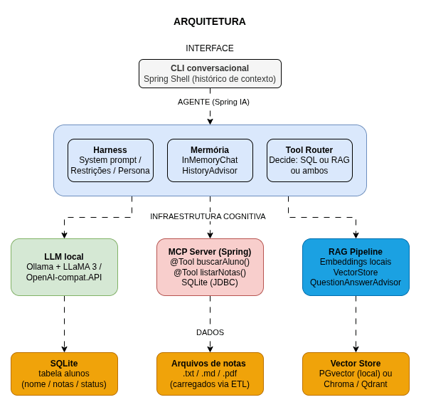
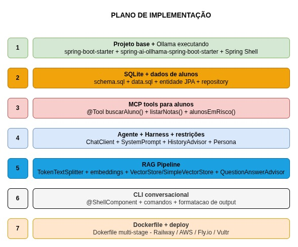

# ai-simple-lab

Laboratorio simples e pratico sobre os principais conceitos de IA.

## problema

Utilizar um modelo de IA que responda a perguntas sobre as notas, a situação e outros dados dos alunos de uma escola de forma conversacional. O modelo deverá usar informações presentes nos documentos da escola e uma fonte de dado transacional.

## tópicos do lab

- INTERFACE
  - CLI conversacional
    - Spring Shell - histórico de contexto
- AGENTE IA / ChatClient / ToolCallbackProvider
  - Harness
    - System prompt
    - Restrições
    - Persona
- INFRAESTRUTURA COGNITIVA
  - Ollama + LLaMA3
  - MCP Server (Spring)
  - RAG Pipeline
- DADOS
  - SQLite
  - Arquivos de notas
  - Vector Store

## arquitetura



## plano de implementacao



## estrutura de pastas

- `apps/escola-poc-agent/`: agente conversacional em Java/Spring Shell; o código fica em `src/main/java` e os relatórios usados pelo RAG em `src/main/resources/notas`.
- `apps/escola-poc-mcp-server/`: servidor MCP em Java/Spring, com as ferramentas e os recursos SQL em `src/main`.
- `apps/ollmcp/`: documentação do cliente Python `ollmcp`, usado para testar a conexão com o servidor MCP.
- `apps/db/`: scripts SQL e dados de exemplo.
- `apps/documents/`: documentos de exemplo para o laboratório.
- `docs/`: diagramas e documentação visual da arquitetura e da implementação.
- `scripts/`: scripts auxiliares, incluindo `run-escola.sh` para compilar e iniciar o servidor MCP e o agente em terminais separados.
- `bin/`: JARs gerados pelo script de inicialização; conteúdo gerado e não versionado.

## run

``` bash

# Pré-requisito — Ollama disponível com os modelos necessários
ollama pull llama3.2
ollama pull nomic-embed-text

# Compila, copia os JARs para bin/ e abre dois terminais:
# terminal 1 — MCP Server; terminal 2 — agente CLI
./scripts/run-escola.sh

```
